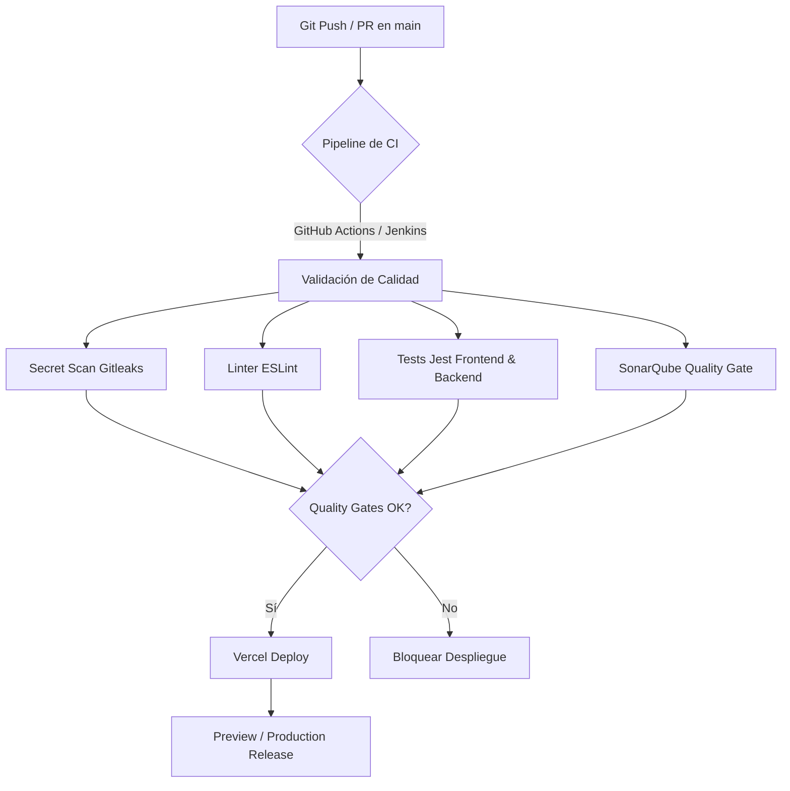

# Guía de Estrategia de Despliegue en Vercel

> **Proyecto**: telegram-messenger  
> **Rol / Skill**: `jc.devops-engineer`  
> **Fecha**: 2026-10-09  
> **Estado**: Listo para producción / Homologación

---

## 1. Diagnóstico de Arquitectura Actual vs. Modelo Serverless Vercel

El repositorio está estructurado como un monorepositorio con dos componentes principales:
1. **Frontend (`frontend/`)**: React 18 + Vite SPA compilado a archivos estáticos (`dist/`).
2. **Backend (`backend/`)**: Node.js + Express (`src/app.js`, `src/server.js`) con endpoints `/health` y `/api/send-message`.

### ⚠️ Hallazgos Críticos sobre la Configuración Inicial (`vercel.json`)
El archivo inicial `vercel.json` presente en la raíz utilizaba la clave `"services"` (`express` y `vite`), la cual no es el estándar nativo de Vercel para Serverless Functions ni maneja correctamente la ejecución serverless en la capa gratuita/estándar de Vercel.

En Vercel existen **dos estrategias de despliegue válidas**. A continuación se detallan ambas opciones y se recomienda la opción óptima para este proyecto.

---

## 2. Estrategias de Despliegue Disponibles

### Opción A (Recomendada: Monorepo Serverless Unificado en Vercel)
Desplegar **Frontend y Backend dentro del mismo proyecto de Vercel**, exponiendo el backend Express como una **Vercel Serverless Function** en `/api`.

* **Ventajas**:
  * Un solo dominio (`https://tu-proyecto.vercel.app`).
  * **Cero problemas de CORS**: Las peticiones del frontend viajan en el mismo origen hacia `/api/send-message`.
  * Un solo panel y pipeline de despliegue en Vercel.
  * Auto-escalado a 0 cuando no hay uso (costo $0 en Free Tier).
* **Adaptación técnica requerida**:
  * Exportar la instancia de Express (`app`) como un handler de Serverless Function bajo `api/index.js` (o en la raíz del proyecto para Vercel).
  * En `frontend/.env` de producción en Vercel, `VITE_BACKEND_URL` puede ser relativo (ej. vacío o `/api`) o apuntar al mismo dominio.

---

### Opción B (Despliegue Desacoplado: 2 Proyectos en Vercel o Backend Contenedor)
* **Frontend**: Proyecto Vercel apuntando a `Root Directory: frontend`.
* **Backend**: Proyecto Vercel Serverless independiente apuntando a `Root Directory: backend`, o desplegado en un host de contenedores (Railway, Render, Fly.io, AWS ECS) consumiendo el `backend/Dockerfile` ya existente.
* **Ventajas**: Ciclos de despliegue independientes.
* **Desventajas**: Requiere configurar CORS explícito (`FRONTEND_URL`), gestionar dos proyectos separados y sincronizar URLs en variables de entorno.

---

## 3. Implementación Paso a Paso de la Mejor Estrategia (Opción A)

### Paso 3.1. Adaptador Serverless para Express
En Vercel, cualquier archivo dentro de `/api` (en la raíz) es tratado como una Serverless Function. Para servir toda la API Express (`/api/health`, `/api/send-message`):

Creamos `api/index.js` en la raíz del repositorio:
```javascript
const createApp = require('../backend/src/app');
const app = createApp();

module.exports = app;
```
*Vercel toma la instancia de Express exportada y la ejecuta como una función Serverless Node.js.*

---

### Paso 3.2. Configuración Canónica de `vercel.json`
El archivo `vercel.json` en la raíz debe definir la compilación del frontend y el enrutamiento hacia la función serverless:

```json
{
  "version": 2,
  "builds": [
    {
      "src": "frontend/package.json",
      "use": "@vercel/static-build",
      "config": {
        "distDir": "dist"
      }
    },
    {
      "src": "api/index.js",
      "use": "@vercel/node"
    }
  ],
  "routes": [
    {
      "src": "/api/(.*)",
      "dest": "/api/index.js"
    },
    {
      "src": "/(.*)",
      "dest": "/frontend/$1"
    }
  ]
}
```

> **Alternativa moderna (Vercel Build Output API o Multi-Project)**:
> Si se configura en la interfaz de Vercel como dos proyectos separados (Frontend y Backend), cada uno especifica su respectivo `Root Directory` (`frontend` y `backend`).

---

### Paso 3.3. Configuración de Variables de Entorno en Vercel

Todas las variables deben cargarse en el Dashboard de Vercel (**Project Settings > Environment Variables**) para los entornos **Production**, **Preview** y **Development**:

| Variable | Tipo / Alcance | Descripción / Valor Recomendado |
| :--- | :--- | :--- |
| `TELEGRAM_BOT_TOKEN` | Secreto (Backend) | Token otorgado por @BotFather. **NUNCA subir al repo**. |
| `TELEGRAM_API_URL` | Config (Backend) | `https://api.telegram.org` |
| `FRONTEND_URL` | Config (Backend) | URL de producción (`https://tu-proyecto.vercel.app`) o `*` en Preview |
| `VITE_BACKEND_URL` | Build-time (Frontend) | URL del backend (ej. `https://tu-proyecto.vercel.app` o dejar vacío si se usan rutas relativas) |

> 🔒 **Regla de Seguridad DevSecOps**:
> El `.gitleaks.toml` del repositorio bloqueará cualquier intento de commit con tokens en texto plano. Usar exclusivamente la consola de Vercel o el CLI `vercel env add`.

---

## 4. Estrategia de CI/CD para Despliegues

Existen dos vías recomendadas para operar el despliegue:



### Flujo Automático Git-Integration (Recomendado)
1. Conectar el repositorio de GitHub (`https://github.com/jhee1995/telegram_messenger.git`) directamente a Vercel.
2. Cada **Pull Request** genera automáticamente un entorno de **Preview** efímero.
3. Al hacer merge a **`main`**, Vercel despliega automáticamente a **Production**.
4. Se configuran **Vercel Ignored Build Step** o status checks de GitHub para garantizar que Jenkins / CI haya aprobado los tests antes de publicar el despliegue.

### Flujo Vercel CLI vía Pipeline (CI/CD Controlado)
Si se desea que el despliegue sea ordenado estrictamente por Jenkins o GitHub Actions tras validar SonarQube:
```bash
# Instalación y despliegue usando tokens en CI
npm install -g vercel
vercel pull --yes --environment=production --token=$VERCEL_TOKEN
vercel build --prod --token=$VERCEL_TOKEN
vercel deploy --prebuilt --prod --token=$VERCEL_TOKEN
```

---

## 5. Checklist de Verificación Post-Despliegue (Smoke Testing)

1. [ ] **Health Check**:
   Ejecutar `curl -i https://<tu-app>.vercel.app/api/health`.
   *Esperado: `HTTP 200 OK` con `{"status":"ok"}`*.
2. [ ] **Frontend Loading**:
   Acceder a `https://<tu-app>.vercel.app` en el navegador; verificar carga de assets Vite sin errores 404 ni pantalla blanca.
3. [ ] **Envío de Mensaje de Prueba**:
   Completar el formulario con Chat ID y mensaje; verificar recepción en Telegram y respuesta JSON `{ "success": true, "messageId": ... }`.
4. [ ] **Rate Limiting & Cold Starts**:
   Validar que el cold-start sea inferior a 1.5s y que la cuota de rate-limiting no bloquee peticiones legítimas.
